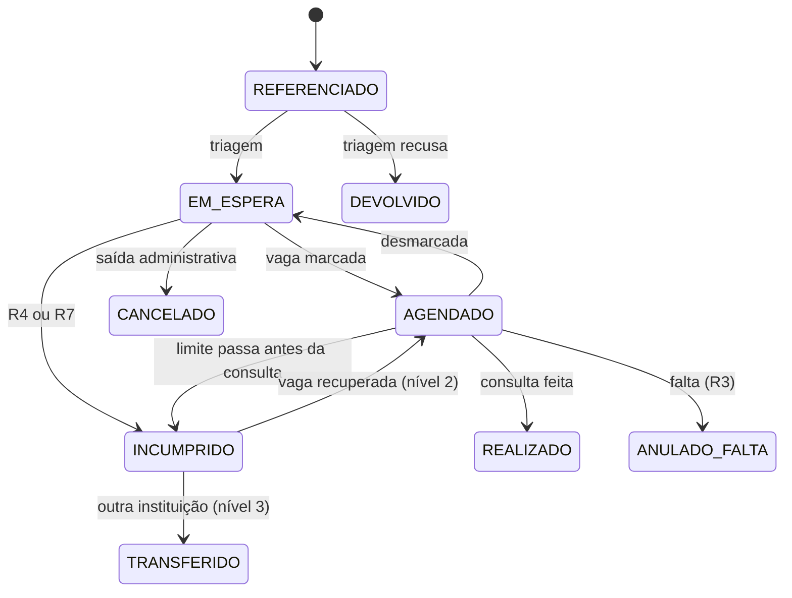
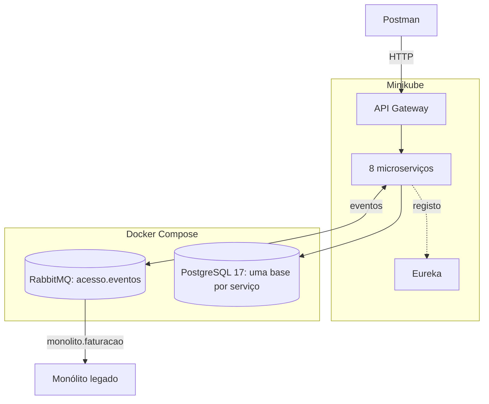

# Acesso a Tempo

**Lista de espera e TMRG da consulta externa hospitalar, em microserviços.**

Trabalho prático de Métodos e Técnicas de Suporte ao Desenvolvimento de Software, Mestrado em Engenharia Informática, ESTG, 2026/2027.

Grupo 5: Alton Freitas, Avelino Almeida, Nuno Silva e Pedro Leite.
Docentes: Ricardo Santos e Célio Carvalho.

## Resumo

O tema é o acesso à primeira consulta hospitalar numa unidade local de saúde do SNS, a ULS Lusitânia (fictícia), e o cumprimento do Tempo Máximo de Resposta Garantido (TMRG). Cada pedido de consulta tem um prazo fixado por lei. Quando a procura ultrapassa a capacidade, a lista de espera cresce e os prazos esgotam-se.

O circuito de acesso sai do sistema monolítico atual para 8 microserviços em Spring Boot e Spring Cloud, com API Gateway, Eureka, RabbitMQ e uma base de dados por serviço. Não há interface gráfica: os utilizadores são simulados com o Postman. Corre em Docker Compose no desenvolvimento e no Minikube na entrega.

## Como arrancar

Requisitos: JDK 17, Docker Desktop e Git.

```
git clone git@github.com:mtsds-grupo5/acesso-a-tempo.git
cd acesso-a-tempo
cp .env.exemplo .env          # Windows: Copy-Item .env.exemplo .env
docker compose up -d          # PostgreSQL, pgAdmin e RabbitMQ
./mvnw verify                 # Windows: .\mvnw.cmd verify
```

- Gateway: http://localhost:8080
- RabbitMQ: http://localhost:15672
- pgAdmin: http://localhost:9999

O Eureka já não é preciso para arrancar: a gateway encaminha para endereços fixos (`localhost:<porta>`, ou o nome do serviço no perfil `k8s`). Só a demonstração do registo dos utentes o usa: arranque o Eureka (http://localhost:8761) e os serviços com o perfil `eureka`.

### Imagem Docker de um serviço

Cada serviço tem um `Dockerfile` que só copia o jar: primeiro constrói-se o jar, depois a imagem. Tudo o que muda entre ambientes entra por variáveis de ambiente. Exemplo com a gestao-acesso, ligada ao PostgreSQL e ao RabbitMQ do Docker Compose (rede `acesso-a-tempo_default`):

```
./mvnw -pl gestao-acesso -am package -DskipTests
docker build -t acesso/gestao-acesso gestao-acesso
docker run --rm -p 8084:8084 --network acesso-a-tempo_default \
  -e SPRING_PROFILES_ACTIVE=docker \
  -e DB_URL=jdbc:postgresql://postgres:5432/gestao_acesso_db \
  -e DB_USER=gestao_acesso -e DB_PASSWORD=Grupo5 \
  -e RABBITMQ_HOST=rabbitmq \
  acesso/gestao-acesso
```

No PowerShell, troque o `\` do fim das linhas por `` ` ``. Dentro da rede do Compose, a base e o RabbitMQ chamam-se `postgres` e `rabbitmq`, não `localhost`. A landing fica em http://localhost:8084/gestao-acesso/landing.

## O problema e a solução

| Problema | Solução |
|---|---|
| O cumprimento do TMRG só se conhece nos relatórios mensais, quando o prazo já passou. | Todos os prazos são verificados todos os dias, com aviso aos 75% e no incumprimento, e cada caso é tratado por níveis. |
| As regras estão no código: cada nova portaria obriga a republicar tudo. | As regras ficam numa tabela com versões e data de vigência. |
| O pico das 8h nas agendas afeta a faturação e o internamento, no mesmo servidor. | Cada serviço tem a sua base de dados e escala à parte. |
| Ninguém vê que episódios estão em risco nem como a lista evolui. | Indicadores diários da lista, do cumprimento e da triagem. |

A migração segue o padrão **Strangler Fig**, um serviço de cada vez. Faturação e internamento ficam no monólito, que recebe os episódios fechados pela fila `monolito.faturacao`. A lista de espera atual entra por um ficheiro CSV, convertido por uma camada anticorrupção.

## Regras de negócio

Prazos da Portaria n.º 153/2017, contados desde o registo do pedido. O alerta aos 75% é regra do grupo.

| Prioridade | Prazo | Alerta "em risco" |
|---|---|---|
| Muito prioritária | 30 dias | 75% do prazo |
| Prioritária | 60 dias | 75% do prazo |
| Normal | 120 dias | 75% do prazo |

| Regra | Descrição |
|---|---|
| R1 | A contagem começa na data do pedido. A triagem não a reinicia. |
| R2 | Data-limite = data do pedido + prazo. Uma reavaliação recalcula a partir da mesma data. |
| R3 | Uma falta à primeira consulta anula o pedido, que volta ao médico de família. |
| R4 | Incumprimento: a data-limite passou sem consulta realizada. |
| R5 | Incumprimento previsto: consulta marcada depois da data-limite. |
| R6 | Três níveis: registar; alertar o diretor de serviço (5 dias úteis para reagendar); propor outra instituição. |
| R7 | Se a prioridade sobe e a nova data-limite já passou, entra logo em incumprimento. |
| R8 | Marcação automática: as vagas livres de uma especialidade são atribuídas aos episódios em espera por ordem de data-limite, os mais próximos primeiro (empate: pedido mais antigo). |



"Em risco" é um alerta, não um estado. Uma transição fora destas dá 409.

## Arquitetura



- Todos os pedidos entram pela **API Gateway**, que valida o cabeçalho `X-Utilizador` (401 e 403).
- Os serviços registam-se no **Eureka**; a gateway distribui os pedidos com o LoadBalancer.
- Cada serviço tem a sua **base de dados e utilizador**, sem acesso às dos outros.
- Só há duas chamadas HTTP entre serviços, ambas para `utentes`. Tudo o resto são **eventos** no RabbitMQ, com idempotência e Dead-Letter Exchange. Os eventos levam só identificadores, nunca dados pessoais.

| Serviço | Subdomínio | Responsabilidade | Parte |
|---|---|---|---|
| referenciacao | Suporte | Receção e triagem dos pedidos | 1, Nuno Silva |
| agendamento | Suporte | Agendas, vagas, marcações, realização e falta | 1, Nuno Silva |
| lista-espera | Principal | Episódio de espera: estados, histórico e saída | 2, Avelino Almeida |
| gestao-acesso | Principal | Regras com versões, data-limite, alertas de risco e incumprimento | 2, Avelino Almeida |
| garantia-acesso | Principal | Escalada em três níveis e transferência | 3, Alton Freitas |
| historico | Suporte | Indicadores da lista, do cumprimento e da triagem | 3, Alton Freitas |
| utentes | Genérico | Identificação, contactos, consentimentos e registo de acessos | 4, Pedro Leite |
| notificacoes | Genérico | Mensagens, lembretes e reenvio | 4, Pedro Leite |

Fluxo principal de eventos: `pedido.triado` → `episodio.inscrito` → `prazo.definido` → `consulta.agendada` → `consulta.realizada` ou `consulta.falta-registada`. Em paralelo, o gestao-acesso emite `prazo.em-risco` e `prazo.ultrapassado`, a que o garantia-acesso reage. São 24 tipos de evento no total.

## Tecnologias

Java 17, Spring Boot e Spring Cloud (Gateway, Eureka, LoadBalancer, OpenFeign), Spring Data JPA, PostgreSQL 17, RabbitMQ, Maven multi-módulo, Docker Compose, Minikube, JUnit com MockMvc e Postman.

## Âmbito

| Fase | Inclui |
|---|---|
| 1. Garantida | Os 8 serviços, gateway, Eureka, eventos do fluxo principal, migração CSV, regras R1 a R4, relógio configurável, Docker Compose, Minikube |
| 2. Planeada | Escalada até ao nível 2, R5 e R7, lembretes, consentimentos, registo de acessos, indicadores de cumprimento e triagem |
| 3. Se houver tempo | Transferência orquestrada (nível 3), projeção da lista, circuit breaker, tracing distribuído |

A autenticação fica fora do âmbito: o Postman envia o utilizador e o papel no cabeçalho `X-Utilizador`.
