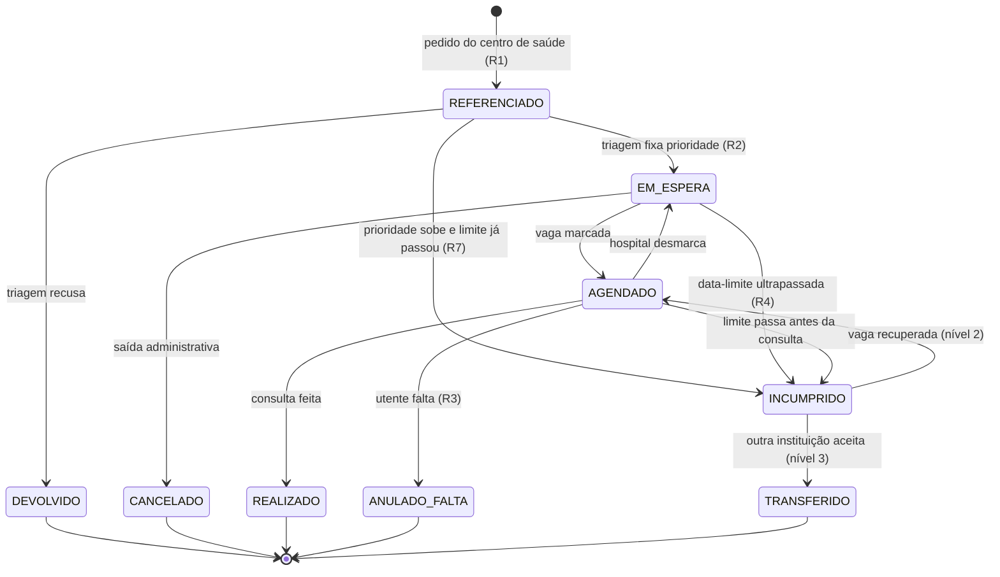
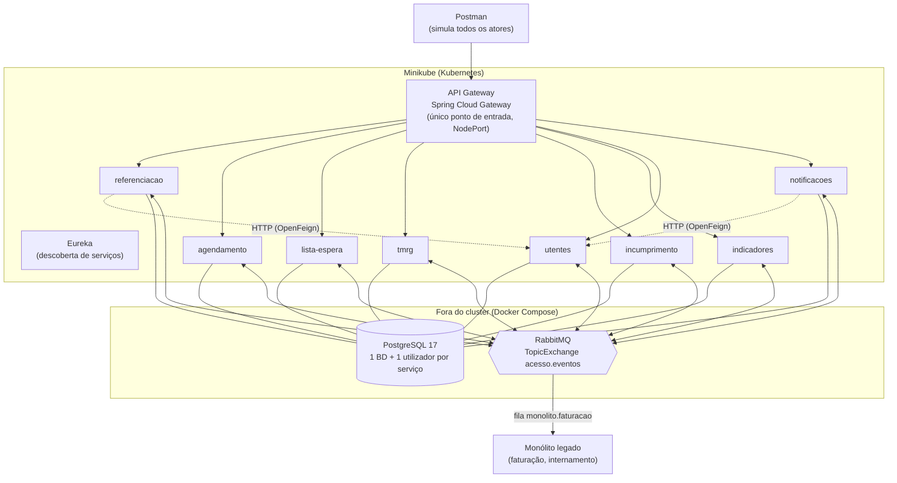
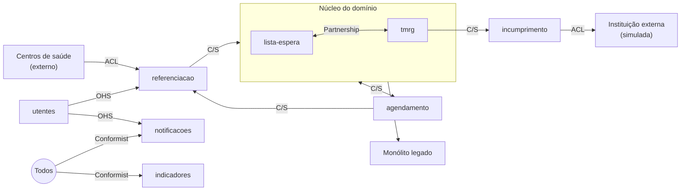
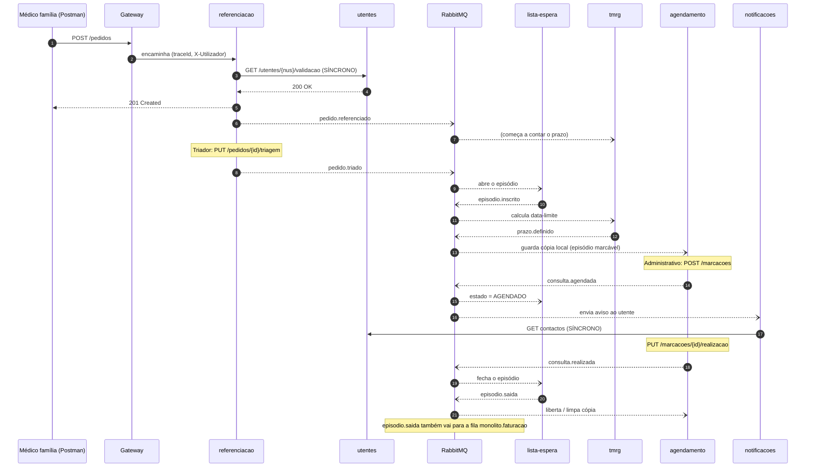

# Acesso a Tempo — Explicação da proposta (Grupo 5)

> Documento de apoio para perceber **o que vamos desenvolver** e **como as peças se ligam**.
> Baseado em `src/_MTSDS__Proposta_de_Sistema_Grupo_05.pdf`. As secções marcadas com 💡 são sugestões minhas, que não estão no documento original.

---

## Índice

1. [Contexto do negócio (versão simples)](#1-contexto-do-negócio-versão-simples)
2. [Arquitetura do sistema](#2-arquitetura-do-sistema)
3. [RabbitMQ: quando usar síncrono e quando usar assíncrono](#3-rabbitmq-quando-usar-síncrono-e-quando-usar-assíncrono)
4. [O problema e a solução](#4-o-problema-e-a-solução)
5. [Dependências no desenvolvimento](#5-dependências-no-desenvolvimento)
6. [Entrega e teste pelo professor](#6-entrega-e-teste-pelo-professor)
7. [Resumo numa página](#7-resumo-numa-página)

---

## 1. Contexto do negócio (versão simples)

### 1.1 A história em poucas linhas

Imagina um hospital público (a **ULS Lusitânia**, fictícia). Um utente vai ao **médico de família** no centro de saúde e este acha que o utente precisa de ser visto por um especialista (ex.: cardiologia). O médico de família envia um **pedido de primeira consulta** para o hospital.

No hospital:

1. Um **médico triador** olha para o pedido e decide: aceito ou devolvo? Se aceitar, atribui uma **prioridade**.
2. A prioridade define um **prazo máximo legal** para a consulta acontecer — o **TMRG** (Tempo Máximo de Resposta Garantido):

| Prioridade        | Prazo máximo | Alerta "em risco" (regra interna) |
|-------------------|--------------|-----------------------------------|
| Muito prioritária | 30 dias      | aos 75% do prazo (dia 22/23)      |
| Prioritária       | 60 dias      | aos 75% do prazo (dia 45)         |
| Normal            | 120 dias     | aos 75% do prazo (dia 90)         |

3. O pedido entra na **lista de espera** como um **episódio**, com uma **data-limite** = data do pedido + prazo.
4. Um **administrativo** marca a consulta numa vaga da agenda (dando preferência a quem está mais perto do limite).
5. O utente vai à consulta → **realizado** (o episódio fecha). Se faltar → o pedido é **anulado** e volta ao médico de família.
6. Se a data-limite passar sem consulta → **incumprimento**, e o hospital tem de reagir.

Os prazos estão na **Portaria n.º 153/2017** e a **Entidade Reguladora da Saúde (ERS)** fiscaliza o seu cumprimento. Ou seja: **não cumprir é um problema legal e de reputação**, não só operacional.
### 1.2 Números (fictícios) para ter noção da escala

- 450 mil utentes inscritos
- 180 mil primeiras consultas por ano
- 60 especialidades
- 3 níveis de prioridade

### 1.3 As regras de negócio que importam (R1–R7)

| Regra | Em linguagem simples |
|-------|----------------------|
| **R1** | O relógio começa a contar **no dia do pedido**, não no dia da triagem. A triagem não "reinicia" o prazo. |
| **R2** | Data-limite = data do pedido + prazo da prioridade. Se a prioridade for reavaliada, recalcula-se **a partir da mesma data do pedido**. |
| **R3** | Faltar à primeira consulta **anula** o pedido (volta ao médico de família). |
| **R4** | Incumprimento = a data-limite passou e a consulta não foi feita. |
| **R5** | Incumprimento **previsto** = a consulta foi marcada para depois da data-limite. |
| **R6** | O incumprimento é tratado em **3 níveis**: (1) registar e reportar → (2) alertar o diretor de serviço, que tem **5 dias úteis** para reagendar → (3) propor a consulta **noutra instituição**. |
| **R7** | Se a prioridade sobe e a nova data-limite **já passou**, o episódio entra logo em incumprimento. |

> As regras do TMRG (prazos, %) ficam guardadas numa **tabela com versões e data de vigência**, não no código. Se sair uma nova portaria, cria-se uma nova versão sem republicar o serviço. Cada episódio usa a versão em vigor na data do pedido.

### 1.4 O ciclo de vida de um episódio



⚠️ **"Em risco" não é um estado**, é um **alerta** (aos 75% do prazo). O episódio continua em `EM_ESPERA` ou `AGENDADO`.

### 1.5 Quem usa o sistema (atores)

Não há interface gráfica: **todos os atores são simulados com pedidos no Postman** à API Gateway.

| Ator | O que faz |
|------|-----------|
| Médico de família | Referencia o utente (envia o pedido) |
| Médico triador | Aceita/devolve o pedido e fixa a prioridade; pode reavaliar |
| Administrativo | Marca consultas, regista realização ou falta |
| Diretor de serviço | Reagenda casos em incumprimento (5 dias úteis) |
| Gestor de acesso | Acompanha a lista, gere as regras TMRG, propõe consulta noutra instituição |
| Utente | Consulta a sua marcação, recebe avisos |
| **Relógio do sistema** | Tarefa agendada no `tmrg` que verifica os prazos todos os dias e dispara alertas |

---

## 2. Arquitetura do sistema

### 2.1 Ponto de partida: o monólito

Hoje existe **uma aplicação monolítica com uma única base de dados**: utentes, referenciação, lista de espera, agendas, internamento, farmácia e faturação — tudo junto.

**Só a parte que está sob pressão sai do monólito** (o circuito de acesso à primeira consulta). Internamento, farmácia e faturação **ficam no monólito**. O monólito **não vai ser construído** neste trabalho — só é representado pelas suas ligações (uma fila de saída e um CSV de entrada).

A migração segue o padrão **Strangler Fig** (estrangular o monólito aos poucos), um serviço de cada vez:

```
tmrg → lista-espera → indicadores → referenciacao → agendamento → incumprimento (novo, não existe hoje)
```

### 2.2 Vista geral



**Peças de infraestrutura:**

| Peça | Para que serve |
|------|----------------|
| **API Gateway** (Spring Cloud Gateway) | Porta de entrada única. Verifica o cabeçalho `X-Utilizador` (401 se faltar, 403 se o papel não tiver permissão), gera o `traceId` e encaminha para o serviço certo. |
| **Eureka** | Os serviços registam-se lá; a gateway e o OpenFeign descobrem-nos pelo nome. Usa-se o Eureka mesmo no Kubernetes para ter **um só mecanismo de descoberta**. |
| **Spring Cloud LoadBalancer** | Distribui pedidos pelas réplicas (ex.: 2 réplicas de `agendamento`). |
| **RabbitMQ** | Uma TopicExchange `acesso.eventos` por onde passam **todos os eventos**. |
| **PostgreSQL** | Uma instância, mas **uma base de dados e um utilizador por serviço**, sem permissões cruzadas (*database per service*). |

### 2.3 Os 8 microserviços

As cores do DDD: 🟧 **principal** (o coração do negócio, feito com mais cuidado), 🟦 **suporte** (necessário mas simples), ⬜ **genérico** (no mundo real seria um produto comprado).

| Serviço | Tipo | Responsabilidade | Porque é um serviço à parte |
|---------|------|------------------|-----------------------------|
| `referenciacao` | 🟦 suporte | Recebe pedidos dos centros de saúde e regista a triagem | Fronteira com o exterior (camada anticorrupção); pico às 8h |
| `agendamento` | 🟦 suporte | Agendas, vagas, marcações, realização, falta | Maior carga do sistema; tem de escalar sozinho |
| `lista-espera` | 🟧 principal | O episódio: estado, histórico, saída | **Fonte de verdade** do episódio |
| `tmrg` | 🟧 principal | Regras versionadas, data-limite, alertas, relógio | Regras mudam por portaria |
| `incumprimento` | 🟧 principal | Escalada em 3 níveis e transferência | Não existe hoje; tem orquestração própria |
| `indicadores` | 🟦 suporte | Indicadores agregados (tamanho da lista, cumprimento…) | Consultas pesadas não podem atrasar marcações |
| `utentes` | ⬜ genérico | Identificação, contactos, consentimentos, registo de acessos | Dados pessoais **num só sítio** |
| `notificacoes` | ⬜ genérico | Mensagens, lembretes 48h antes, reenvio | Uma falha de envio não pode travar marcações |

Total: **45 endpoints** (sem contar os `/landing`) e **22 tipos de evento**.

### 2.4 Como os serviços se relacionam (mapa de contexto)



Legenda rápida:
- **ACL (camada anticorrupção):** um "tradutor" que impede que o modelo de outro sistema contamine o nosso (ex.: o formato do pedido dos centros de saúde, o CSV do monólito).
- **C/S (Customer/Supplier):** o serviço a jusante depende do que o serviço a montante publica.
- **Partnership:** `lista-espera` e `tmrg` evoluem juntos.
- **OHS (Open Host Service):** API estável usada por vários (`utentes`).
- **Conformist:** `indicadores` e `notificacoes` aceitam os eventos tal como vêm.

**Ponto importante de DDD:** não existe uma classe `Episodio` partilhada. Cada serviço tem a **sua própria** versão com só o que precisa, e partilham apenas o `episodioId`:

| Termo | `lista-espera` | `tmrg` | `agendamento` | `indicadores` |
|-------|----------------|--------|---------------|---------------|
| Episódio | estado + histórico | data-limite + prazo consumido | só id + data-limite | só contagens |

### 2.5 O fluxo principal, passo a passo



**Em paralelo**, todos os dias o relógio do `tmrg` verifica os prazos:

- 75% consumido → `tmrg.risco-detetado` → `incumprimento`, `agendamento`, `notificacoes` reagem.
- Marcação depois do limite → `tmrg.incumprimento-previsto` (R5).
- Prazo passou → `tmrg.incumprido` → `incumprimento` abre um caso e começa a escalada (nível 1 → 2 → 3).

### 2.6 Convenções comuns a todos os serviços

- **3 camadas:** controller → service → repository (Spring Data JPA).
- **DTO sempre** (RNF10): as entidades JPA nunca saem do serviço. ModelMapper para converter.
- **`/landing`** em cada serviço para confirmar que responde; **Actuator** só com `/health` e `/metrics`.
- **Erros** tratados num `@ControllerAdvice` com formato comum:
  ```json
  { "servico": "agendamento", "estado": 409, "erro": "VAGA_OCUPADA",
    "mensagem": "A vaga de 12/03/2027 às 10:30 já está ocupada. Escolha outra.",
    "caminho": "/marcacoes", "dataHora": "2027-03-01T09:14:05", "traceId": "4bf92f3577b34da6" }
  ```
- **Listas sempre paginadas** (`page` desde 0, `size` 20 por omissão, máx. 100 → acima disso 400).
- **Histórico** de cada mudança de estado do episódio com data e autor (RNF04).
- **Logs** com SLF4J/Logback, com `traceId` e **sem dados pessoais**.
- **Relógio configurável** (RNF07) para simular a passagem do tempo nos testes/demo.

### 2.7 Disponibilização

- **Desenvolvimento:** Docker Compose.
- **Entrega:** Minikube dentro de uma VM (Vagrant + VirtualBox, exportada em `.ova`).
- Cada serviço = 1 **Deployment** (config em ConfigMap, passwords em Secret).
- Só o **Eureka** (ClusterIP) e a **Gateway** (NodePort) têm Service do Kubernetes.
- `agendamento` e `referenciacao` com **2 réplicas**; o Kubernetes usa `/actuator/health` para recriar serviços que falham.
- **PostgreSQL e RabbitMQ fora do cluster** (Docker Compose com volumes) para não gerir estado dentro do Kubernetes.

### 2.8 💡 Sugestões de melhoria

A arquitetura está bem pensada (DDD, uma BD por serviço, eventos sem dados pessoais, idempotência, DLX, ACL para o legado). As sugestões abaixo são para fechar pontos que costumam dar problemas na implementação ou na defesa.

#### a) Problema do "dual write" → Transactional Outbox *(a mais importante)*

Quando um serviço faz `save()` na BD e depois `rabbitTemplate.convertAndSend(...)`, pode acontecer:
- a BD faz commit mas o RabbitMQ falha → **o evento perde-se** e os outros serviços nunca sabem;
- o evento sai mas a transação faz rollback → **os outros serviços reagem a algo que não aconteceu**.

**Sugestão:** padrão **Transactional Outbox**: na mesma transação grava-se o dado **e** uma linha numa tabela `outbox`; uma tarefa `@Scheduled` lê a `outbox`, publica no RabbitMQ (com *publisher confirms*) e marca como enviada. É simples de implementar e casa bem com a idempotência que já está prevista nos consumidores (entrega *at-least-once*).

Alternativa mínima, se não houver tempo: publicar em `@TransactionalEventListener(phase = AFTER_COMMIT)` + *publisher confirms* + log de erro.

#### b) Ordem dos eventos

O RabbitMQ só garante ordem **dentro de uma fila e com um único consumidor**. Com 2 réplicas de `agendamento` a consumir a mesma fila, `prazo.definido` e `prioridade.reavaliada` do mesmo episódio podem ser processados fora de ordem, e a cópia local pode ficar com a data-limite antiga.

**Sugestão:** incluir no evento um **número de versão do episódio** (ou `ocorridoEm`) e o consumidor **ignora eventos mais antigos** do que o que já tem guardado. Também validar transições de estado na `lista-espera` (ex.: não passar de `REALIZADO` para `AGENDADO`).

#### c) Envelope comum dos eventos

Definir já na "base comum" (Parte 4) um formato único:
```json
{ "eventoId": "uuid", "tipo": "prazo.definido", "versaoEsquema": 1,
  "ocorridoEm": "2027-03-01T09:14:05", "episodioId": "...", "versaoEpisodio": 3,
  "traceId": "4bf92f3577b34da6", "dados": { "dataLimite": "2027-04-01", "versaoRegra": 2 } }
```
- `eventoId` → idempotência (já prevista).
- `versaoEsquema` → permite evoluir eventos sem partir consumidores.
- `traceId` também nos **headers da mensagem** → permite seguir um pedido pelos logs mesmo através do RabbitMQ (hoje só está garantido nas chamadas HTTP).

#### d) Concorrência na marcação de vagas

Com 2 réplicas de `agendamento` e o pico das 8h, dois administrativos podem marcar a mesma vaga ao mesmo tempo. **Sugestão:** `@Version` (optimistic locking) na entidade `Vaga` e/ou **restrição UNIQUE** na BD (vaga ↔ marcação ativa); a exceção é traduzida para o `409 VAGA_OCUPADA` que já está previsto.

#### e) Resiliência das chamadas síncronas mais cedo

O circuit breaker (Resilience4j) está na **Fase 3 ("se houver tempo")**, mas as duas únicas chamadas síncronas dependem dele para cumprir o RNF02. **Sugestão:** pelo menos **timeout + retry com backoff** do OpenFeign na Fase 1 (é só configuração), e circuit breaker na Fase 2 para `referenciacao → utentes`.

#### f) Tarefa agendada com várias réplicas

O relógio diário do `tmrg` é um `@Scheduled`. Hoje o `tmrg` tem 1 réplica, mas se um dia escalar, a verificação corre **N vezes** e gera alertas duplicados. **Sugestão:** ShedLock (lock na BD) — ou pelo menos documentar que o `tmrg` tem de ter 1 réplica.

#### g) Timeout da transferência (saga)

No nível 3, se a instituição externa **não responder**, quem decide que o prazo acabou? **Sugestão:** o `incumprimento` guarda `respostaAte` na transferência e uma tarefa agendada publica `transferencia.recusada` (compensação) quando o prazo expira. Assim a saga nunca fica "pendurada".

#### h) Reprocessamento da Dead-Letter Queue

A DLX está prevista, mas falta dizer **o que se faz** às mensagens lá. **Sugestão:** um endpoint de administração simples (ou instrução no relatório via painel do RabbitMQ) para **reenviar** mensagens da DLQ depois de corrigir o problema.

#### i) Segurança do cabeçalho `X-Utilizador`

Os serviços confiam no `X-Utilizador` que vem da gateway. Como só a gateway está exposta (NodePort) isto é aceitável no âmbito, mas convém que a **gateway remova/rescreva o cabeçalho** que chega de fora e o volte a pôr após validar — e referir no relatório que em produção seria um JWT.

#### j) (Opcional, para discussão) `lista-espera` + `tmrg`

Estão em **Partnership** e trocam muitos eventos sobre o mesmo episódio; o `tmrg` consome 11 eventos só para acompanhar o estado. É uma separação defensável (as regras mudam por portaria), mas é provável que perguntem na defesa *"porque não é um só serviço?"*. Tenham a resposta preparada: **ritmo de mudança diferente** (regras legais vs. ciclo de vida) e **tarefa agendada pesada** isolada do serviço que responde ao utente.

---

## 3. RabbitMQ: quando usar síncrono e quando usar assíncrono

### 3.1 A regra de decisão

Primeiro, uma clarificação: no projeto **o RabbitMQ é só para a comunicação assíncrona**. A comunicação síncrona é feita por **HTTP com OpenFeign** (não se usa RPC sobre RabbitMQ).

> **Síncrono (HTTP/OpenFeign)** → só quando o serviço que chama **não consegue continuar sem a resposta, agora**.
> **Assíncrono (evento no RabbitMQ)** → em **todos os outros casos**: "aconteceu X, quem estiver interessado que reaja".

Perguntas a fazer em cada interação:

| Pergunta | Se SIM → |
|----------|----------|
| Preciso da resposta para responder ao utilizador **neste pedido**? | Síncrono |
| Estou só a **avisar** que algo mudou? | Assíncrono |
| Se o outro serviço estiver em baixo, a minha operação **deve falhar**? | Síncrono |
| Se o outro estiver em baixo, a minha operação deve **continuar** e ele apanha depois? | Assíncrono |
| Há **vários** interessados na mesma informação? | Assíncrono (um evento, N consumidores) |

### 3.2 Comunicações **síncronas** (HTTP via OpenFeign)

Só existem **duas**, ambas para o `utentes` (porque é o único sítio com dados pessoais — RNF03):

| Quem chama | Quem responde | Para quê | Porque é síncrono | Se falhar |
|------------|---------------|----------|-------------------|-----------|
| `referenciacao` | `utentes` | Validar o NUS/utente **antes** de aceitar o pedido | Não se pode criar um pedido para um utente que não existe; a resposta ao centro de saúde depende disso | Timeout de 2s → **503**, pedido não é criado; o centro de saúde reenvia (o nº do pedido evita duplicados) |
| `notificacoes` | `utentes` | Obter o contacto **atual** antes de enviar a mensagem | Os contactos não podem andar nos eventos (sem dados pessoais) nem ser copiados | A notificação fica **pendente** e é reenviada até 3 vezes |

Mais as chamadas "de fora para dentro": **Postman → Gateway → serviço** (HTTP normal).

### 3.3 Comunicações **assíncronas** (eventos no RabbitMQ)

Tudo o resto. Os **22 eventos** e quem publica/consome:

| Evento (routing key) | Publica | Consome | Significado |
|---|---|---|---|
| `pedido.referenciado` | referenciacao | tmrg, indicadores | Começa a contagem |
| `pedido.triado` | referenciacao | lista-espera, tmrg, indicadores | Pedido aceite → abre o episódio |
| `prioridade.reavaliada` | referenciacao | lista-espera, tmrg, indicadores | Recalcular data-limite |
| `pedido.devolvido` | referenciacao | indicadores, notificacoes | Pedido recusado na triagem |
| `episodio.inscrito` | lista-espera | tmrg, agendamento, indicadores | Episódio entra na lista |
| `prazo.definido` | tmrg | lista-espera, agendamento | Data-limite e versão da regra |
| `consulta.agendada` | agendamento | lista-espera, tmrg, incumprimento, indicadores, notificacoes | Consulta marcada |
| `consulta.realizada` | agendamento | lista-espera, tmrg, indicadores | Consulta feita → fecha |
| `consulta.falta-registada` | agendamento | lista-espera, referenciacao, tmrg, indicadores, notificacoes | Falta → anula (R3) |
| `consulta.desmarcada` | agendamento | lista-espera, tmrg | Volta à espera |
| `tmrg.incumprimento-previsto` | tmrg | incumprimento, agendamento, indicadores | Marcado após limite (R5) |
| `tmrg.risco-detetado` | tmrg | incumprimento, agendamento, indicadores, notificacoes | 75% do prazo |
| `tmrg.incumprido` | tmrg | lista-espera, incumprimento, indicadores | Prazo ultrapassado (R4) |
| `incumprimento.registado` | incumprimento | indicadores | Nível 1 |
| `incumprimento.diretor-alertado` | incumprimento | agendamento, notificacoes | Nível 2 (5 dias úteis) |
| `transferencia.proposta` | incumprimento | indicadores, instituição externa | Nível 3 |
| `transferencia.aceite` | incumprimento | lista-espera, agendamento, indicadores, notificacoes | Episódio sai para outra instituição |
| `transferencia.recusada` | incumprimento | indicadores | Compensação: episódio mantém-se |
| `incumprimento.resolvido` | incumprimento | indicadores | Caso fechado |
| `utente.consultado` | lista-espera | utentes | Registo de acessos (RF13) |
| `episodio.saida` | lista-espera | tmrg, agendamento, indicadores, **fila `monolito.faturacao`** | Episódio fechado → o legado fatura |
| `relogio.avancado` | tmrg | incumprimento, notificacoes | Nova data simulada (só demo) |

### 3.4 Casos onde seria **tentador** usar síncrono, mas **não se deve**

Estes são os pontos onde é fácil errar na implementação:

| Tentação | Porque não | O que se faz em vez disso |
|----------|-----------|---------------------------|
| `agendamento` perguntar à `lista-espera`/`tmrg` "este episódio pode ser marcado? qual a data-limite?" | Às 8h o `agendamento` tem o maior pico; se depender de outros serviços, cai junto | Guarda uma **cópia local** dos episódios marcáveis, alimentada por `episodio.inscrito` e `prazo.definido` |
| `lista-espera` chamar o `tmrg` para calcular a data-limite | Acoplamento temporal entre os dois serviços do núcleo | `tmrg` publica `prazo.definido` e a `lista-espera` atualiza |
| `agendamento` chamar o `notificacoes` para enviar o aviso | RNF02: falha nas notificações **não pode** impedir marcações | Publica `consulta.agendada`; o `notificacoes` reage quando puder |
| `indicadores` consultar as BDs/APIs dos outros | Consultas pesadas atrasariam as marcações | Constrói o seu **modelo de leitura** a partir de 17 eventos (CQRS "leve") |
| `lista-espera` chamar o monólito para faturar | O monólito não deve ser tocado diretamente | Fila `monolito.faturacao` recebe `episodio.saida` |

**Consequência:** aceita-se **consistência eventual** — durante uns instantes, dois serviços podem ver estados diferentes do mesmo episódio. Exemplo previsto: se o `agendamento` marcar um episódio que entretanto saiu da lista, cancela a marcação e liberta a vaga quando receber `episodio.saida`.

### 3.5 Coreografia vs. orquestração

- **Coreografia (por omissão):** ninguém manda; cada serviço reage aos eventos que lhe interessam. É o fluxo principal (pedido → episódio → prazo → marcação → realização).
- **Orquestração (só uma exceção):** a **transferência para outra instituição (nível 3)**. Tem vários passos e pode ter de ser desfeita, por isso o `incumprimento` coordena (é uma **saga**):

```mermaid
sequenceDiagram
    participant INC as incumprimento (orquestrador)
    participant MQ as RabbitMQ
    participant EXT as Instituição externa (simulada)
    participant LE as lista-espera

    INC--)MQ: transferencia.proposta
    MQ--)EXT: pedido de aceitação
    EXT->>INC: PUT /transferencias/{id}/resposta
    alt aceita
        INC--)MQ: transferencia.aceite
        MQ--)LE: dá saída ao episódio (TRANSFERIDO)
    else recusa / sem resposta no prazo
        INC--)MQ: transferencia.recusada (compensação)
        Note over LE: episódio mantém-se na lista;<br/>caso sinalizado à direção clínica
    end
```

### 3.6 Como montar a topologia no RabbitMQ (sugestão concreta)

```
Exchange:  acesso.eventos            (type: topic, durable)
DLX:       acesso.eventos.dlx        (type: topic ou fanout, durable)

Uma fila por SERVIÇO consumidor (não por réplica!):
  lista-espera.eventos   ← bindings: pedido.triado, prioridade.reavaliada, prazo.definido,
                                       consulta.*, tmrg.incumprido, transferencia.aceite
  tmrg.eventos           ← pedido.*, prioridade.reavaliada, episodio.*, consulta.*
  agendamento.eventos    ← episodio.*, prazo.definido, tmrg.risco-detetado,
                           tmrg.incumprimento-previsto, incumprimento.diretor-alertado,
                           transferencia.aceite
  incumprimento.eventos  ← tmrg.*, consulta.agendada, relogio.avancado
  indicadores.eventos    ← # (quase tudo; filtrar os 17 de negócio)
  notificacoes.eventos   ← pedido.devolvido, consulta.agendada, consulta.falta-registada,
                           tmrg.risco-detetado, incumprimento.diretor-alertado,
                           transferencia.aceite, relogio.avancado
  referenciacao.eventos  ← consulta.falta-registada
  utentes.eventos        ← utente.consultado
  monolito.faturacao     ← episodio.saida

Cada fila: x-dead-letter-exchange = acesso.eventos.dlx
```

Regras de ouro (já previstas na proposta):
- **ACK manual** só depois de processar e gravar.
- **Idempotência:** cada consumidor guarda os `eventoId` já processados e ignora repetidos.
- **3 tentativas** falhadas → a mensagem vai para a **DLX** e fica no log.
- **Eventos só com identificadores e datas**, nunca nomes/contactos.
- Com **2 réplicas** do mesmo serviço, ambas ligam-se à **mesma fila** (*competing consumers*): cada mensagem é processada **uma vez** por serviço, não uma vez por réplica.

---

## 4. O problema e a solução

### 4.1 O problema

Quando entram mais pedidos do que há vagas, **a lista cresce e os prazos legais começam a ser ultrapassados**. O sistema atual (monólito) **não ajuda o hospital a reagir a tempo**, por 4 razões:

| # | Problema | Consequência |
|---|----------|--------------|
| 1 | **Reativo:** o cumprimento do TMRG só se conhece nos **relatórios mensais** | Quando se descobre, o prazo **já passou** — não há tempo para agir |
| 2 | **Regras no código:** as regras do TMRG estão programadas | Cada nova portaria obriga a **parar o sistema inteiro** e republicar |
| 3 | **Tudo no mesmo servidor:** às 8h, quando abrem as agendas, a carga **faz cair a faturação e o internamento** | Um pico numa área derruba áreas que nada têm a ver |
| 4 | **Sem visibilidade:** ninguém vê que episódios estão em risco nem quanto a lista vai crescer | Gestão "às cegas" |

### 4.2 A solução

| Problema | Solução no novo sistema |
|----------|-------------------------|
| 1. Reativo | O `tmrg` verifica **diariamente** todos os prazos e emite **alertas aos 75%** (`tmrg.risco-detetado`) e no incumprimento. O `incumprimento` trata cada caso **por níveis** (registar → diretor reagenda em 5 dias úteis → outra instituição). Passa-se de "descobrir depois" para **agir antes**. |
| 2. Regras no código | Regras do TMRG numa **tabela versionada com data de vigência** (`POST /regras`). Nova portaria = nova versão, **sem republicar**. Cada episódio usa a versão em vigor na data do pedido. |
| 3. Carga das 8h | Separar em **microserviços com BD própria**. `agendamento` e `referenciacao` escalam sozinhos (2 réplicas). Faturação e internamento ficam no monólito, **isolados** do pico. Comunicação por **eventos** → uma falha em `notificacoes` ou `indicadores` não trava marcações. |
| 4. Sem visibilidade | O `indicadores` constrói em tempo (quase) real: tamanho e evolução da lista, taxa de cumprimento, tempo de triagem e **projeção** da lista. O `tmrg` expõe `/monitorizacao` com episódios em risco/incumpridos. |

E ainda, como benefícios adicionais:
- **Rastreabilidade:** histórico de todas as mudanças de estado com data e autor (RNF04) e registo de quem consultou os dados de um utente (RF13).
- **Proteção de dados:** dados pessoais **só** no `utentes`; eventos e indicadores sem dados pessoais.
- **Migração segura:** Strangler Fig (um serviço de cada vez) + migração da lista atual por CSV através de uma camada anticorrupção, com o `tmrg` a recalcular cada data-limite e a assinalar diferenças face ao monólito.

> **Em uma frase:** o sistema transforma o cumprimento dos prazos legais de consulta de algo que se **descobre no fim do mês** em algo que se **acompanha todos os dias e se trata antes de falhar**, isolando a parte do hospital que está sob pressão para que possa escalar e mudar sem afetar o resto.

---

## 5. Dependências no desenvolvimento

> O documento não tem uma análise de dependências. Esta secção é uma dedução minha a partir da ordem de migração, do calendário e das tabelas de eventos do Anexo B.

### 5.1 Duas formas de depender

- **Dependência de código:** não consigo escrever ou compilar a minha parte sem a tua.
- **Dependência de teste:** consigo escrever a minha parte, mas só a vejo a funcionar de ponta a ponta quando a tua existir.

Quase tudo neste projeto tem só a segunda. Cada serviço tem a sua BD e comunica por eventos, por isso **o código de cada serviço pode ser feito em paralelo**. O que se espera é a integração.

### 5.2 O que bloqueia tudo (primeiro e em série)

É a "base comum" do arranque (12/11 a 18/11), atribuída à Parte 4.

| Item | Porque bloqueia |
|---|---|
| Projeto Maven pai (versões Spring Boot 4.1 e Cloud 2025.1) | Todos os serviços herdam dele |
| Formato de erros (`@ControllerAdvice`) e DTOs | Todos os serviços usam o mesmo |
| **Contrato dos eventos:** nomes, campos e formato da mensagem | É a "língua" que os serviços partilham |
| Docker Compose com PostgreSQL (1 BD por serviço) e RabbitMQ | Ninguém corre nada sem isto |
| Eureka e Gateway | Sem eles os serviços não se registam nem recebem pedidos |

💡 Fechar já o contrato dos eventos (campos de cada um) é o que permite trabalhar em paralelo sem esperar pelos colegas.

### 5.3 O que é independente (em paralelo, depois da base)

Em cada serviço, estas partes não dependem de ninguém:

- entidades, repositórios e DTOs;
- endpoints e validações (os 45 do Anexo A);
- regras de estado e testes com MockMvc;
- Dockerfile e configuração do próprio serviço.

Há ainda serviços inteiros que quase não dependem de outros:

| Serviço | Porque é independente |
|---|---|
| `utentes` | Não chama ninguém e só consome 1 evento. **É o melhor para começar**, porque o `referenciacao` precisa dele |
| `indicadores` | Só consome, não publica nada. Na Fase 1 só calcula o tamanho da lista |
| `tmrg` (núcleo) | A tabela de regras versionadas, o cálculo da data-limite e o relógio configurável não precisam de outros serviços |

### 5.4 O que depende de outros (para funcionar de ponta a ponta)

| Serviço | Precisa de | Que parte pode já fazer sozinho |
|---|---|---|
| `referenciacao` | `utentes` (chamada síncrona) | Receção, triagem e estados, com um **stub do `utentes`** |
| `lista-espera` | `pedido.triado` e `prazo.definido` | Modelo do episódio, histórico, endpoints, importação do CSV |
| `agendamento` | `episodio.inscrito` e `prazo.definido` | Agendas, vagas e marcações, com a **cópia local preenchida à mão** |
| `incumprimento` | Eventos `tmrg.*` | Casos, níveis 1 e 2 e a instituição simulada |
| `notificacoes` | `utentes` (síncrono) e eventos | Modelos, reenvio e envio simulado |

### 5.5 O fluxo que define a ordem de integração

```
referenciacao ──pedido.triado──► lista-espera ──episodio.inscrito──► tmrg
                                      ▲                                │
                                      └────────── prazo.definido ──────┤
                                                                       ▼
                               agendamento ◄──── prazo.definido ───────┤
                                    │                                  │
                          consulta.* (volta a lista-espera e tmrg)     │
                                                                       ▼
                                                              incumprimento
```

Folhas, que só consomem e podem ser integradas a qualquer momento: `indicadores`, `notificacoes` e `utentes`.

O `lista-espera` e o `tmrg` dependem um do outro (o documento chama-lhe *Partnership*). Por isso estão na mesma parte (Parte 2) e convém integrá-los **juntos**.

### 5.6 Por fases e calendário

| Quando | Depende do quê | Observação |
|---|---|---|
| **12/11 a 18/11** Arranque | Nada antes | Base comum, gateway, Eureka, RabbitMQ. **Tudo o resto espera por isto** |
| **19/11 a 27/11** Fase 1 | Arranque concluído | Os 8 serviços **em paralelo**, integrados na ordem: `tmrg` → `lista-espera` → `indicadores` → `referenciacao` → `agendamento` → `incumprimento` |
| **28/11 a 03/12** Minikube e Fase 2 | Os serviços a correr em Docker Compose | Os Deployments e ConfigMaps de cada serviço são independentes entre si. A Fase 2 depende da Fase 1 estável |
| **04/12 a 06/12** Fecho | Tudo | Relatório e VM final |

Dentro da Fase 2 há dependências próprias:
- O nível 2 do `incumprimento` depende do nível 1.
- Os lembretes das `notificacoes` dependem do `agendamento` já publicar `consulta.agendada`.
- A Fase 3 (nível 3, circuit breaker, tracing) só faz sentido com a Fase 2 pronta.

O Postman fica com a Parte 1. Pode começar logo a partir do Anexo A, mas só corre de ponta a ponta quando os serviços existirem.

### 5.7 Pontos de atenção para o grupo

1. **A Parte 4 é o caminho crítico.** Entrega a base comum de que todos dependem e o `utentes` de que a Parte 1 depende. Se atrasar, atrasa os outros três. Compensa fazer isto primeiro.
2. **Usar stubs.** Um `utentes` falso que responde sempre 200 deixa a Parte 1 avançar sem esperar.
3. **Semear dados à mão.** O `agendamento` pode ser testado com episódios marcáveis inseridos diretamente na cópia local, sem esperar pela cadeia toda.
4. **Integrar cedo e em pequeno.** Em vez de juntar tudo no fim, liga logo `referenciacao → lista-espera → tmrg` assim que existirem. É o fluxo que, se falhar, estraga o resto.

---

## 6. Entrega e teste pelo professor

### 6.1 O que a proposta diz

- **Entrega principal:** uma **máquina virtual** criada com Vagrant e exportada em VirtualBox (`.ova`), na pasta `MTSDS-Grupo5`, com as instruções para pôr a correr. O Minikube já vai lá dentro. O professor importa a VM e testa, sem instalar nada no PC dele.
- **Código:** no GitHub (`mtsds-grupo5/acesso-a-tempo`), com acesso de leitura para os docentes.
- **Docker Compose:** serve para o desenvolvimento local. Mesmo na entrega, o **PostgreSQL e o RabbitMQ correm fora do Kubernetes**, em Docker Compose com volumes.

### 6.2 Se o professor clonar o repositório

Também pode funcionar, mas só se o repositório estiver preparado para isso. Um Dockerfile por serviço não basta, porque o sistema tem **8 serviços mais Eureka, Gateway, PostgreSQL e RabbitMQ**. Ele precisa de:

| O que | Para quê |
|---|---|
| `docker-compose.yml` na raiz | Sobe tudo com um só comando |
| Dockerfile com *multi-stage build* | Compila o Maven dentro do Docker, para ele não precisar de Java nem Maven |
| Script SQL de arranque | Cria as 8 bases de dados e os 8 utilizadores (uma BD por serviço) |
| Ordem de arranque (`depends_on` e *healthchecks*) | O Eureka e o RabbitMQ têm de estar prontos antes dos serviços |
| `README.md` com passos e exemplos | O professor saber o que correr e o que testar |
| Coleção Postman na pasta do projeto | Ele testar sem montar os pedidos à mão |

Assim ele faz `git clone`, depois `docker compose up --build`, importa a coleção Postman e testa.

Para o Minikube é preciso mais um passo: as imagens têm de ser construídas dentro do Docker do Minikube (por exemplo com `minikube image load`) e aplicar os ficheiros do Kubernetes (`kubectl apply -f`). Convém ter isso num script, tipo `./deploy.sh`.

### 6.3 💡 Sugestão

Garantir os dois caminhos:
1. **A VM `.ova`**, que é a entrega oficial.
2. **O repositório com `docker compose up`**, como plano B caso a VM dê problemas no PC do professor, o que costuma acontecer, por exemplo em Macs com chip Apple, onde o VirtualBox tem limitações.

Antes da entrega, testar num PC limpo, só com `git clone` e o README, para ver se funciona sem ajuda do grupo.

### 6.4 A VM e o Docker Compose dão o mesmo resultado?

Para testar a **lógica do negócio**, sim. A **infraestrutura** é diferente.

**O que é igual:** o código e as imagens Docker são os mesmos. Portanto:
- os mesmos 8 serviços, com os mesmos endpoints e as mesmas regras (R1 a R7);
- os mesmos eventos no RabbitMQ e a mesma BD PostgreSQL;
- o mesmo Eureka e a mesma Gateway;
- a mesma coleção Postman funciona nos dois, só muda o endereço da Gateway.

**O que é diferente:**

| | VM `.ova` (Minikube) | `docker compose up` |
|---|---|---|
| **Orquestrador** | Kubernetes | Só Docker |
| **Réplicas** | `agendamento` e `referenciacao` com 2 réplicas | 1 de cada, a não ser que se configurem mais |
| **Auto-recuperação** | O Kubernetes recria um serviço que falhe (`/actuator/health`) | Só com `restart: always` e *healthchecks* |
| **Configuração e passwords** | ConfigMap e Secret | Ficheiros `.env` ou variáveis no compose |
| **Acesso de fora** | Gateway por NodePort | Porta mapeada no compose |
| **Ambiente** | VM igual para todos | Depende do PC do professor |

**Impacto na avaliação:** o **RNF06** exige disponibilização em Kubernetes com réplicas e verificações de saúde, e **só a VM demonstra isso**. Com o Compose o sistema funciona, mas esse requisito não se vê cumprido. Por isso a VM é a entrega oficial e o Compose é o plano B, para o professor testar a lógica caso a VM falhe no PC dele.

💡 No relatório e no README, dizer claramente que o Compose serve para testar a lógica e que o Kubernetes só se vê na VM.

---

## 7. Resumo numa página

```
                  ┌─────────────────────────────────────────────┐
  Postman ──────► │ API Gateway (X-Utilizador, traceId, rotas)  │◄── Eureka
                  └─────────────────────────────────────────────┘
                         │ HTTP para cada serviço
   ┌──────────────┬──────┴───────┬─────────────┬───────────────┐
   ▼              ▼              ▼             ▼               ▼
referenciacao  agendamento   lista-espera ◄─P─► tmrg      incumprimento
   │ (sync)       (cópia local     (fonte de     (regras,     (níveis 1-3,
   ▼              de episódios)    verdade)      relógio)     saga transf.)
 utentes ◄──(sync)── notificacoes          indicadores (só lê eventos)
                                    
   Todos  ◄──────────►  RabbitMQ  acesso.eventos  (22 eventos, DLX, idempotência)
                              │
                              └──► fila monolito.faturacao ──► Monólito legado
   Cada serviço ──► a sua BD no PostgreSQL (sem acesso às BDs dos outros)
```

**Divisão do trabalho:**

| Parte | Serviços | Trabalho transversal |
|-------|----------|----------------------|
| 1 | referenciacao, agendamento | Coleção Postman |
| 2 | lista-espera, tmrg | Relógio configurável |
| 3 | incumprimento, indicadores | Orquestração da transferência |
| 4 | utentes, notificacoes | Base comum (formato de erros e eventos) |

**Fases:** (1) Garantida — 8 serviços, gateway, Eureka, fluxo principal com DLX, migração CSV, R1–R4, relógio, Docker Compose, Minikube, VM → (2) Planeada — escalada até nível 2, R5 e R7, lembretes, consentimentos, registo de acessos, indicadores completos → (3) Se houver tempo — transferência (nível 3), projeção, circuit breaker, tracing distribuído.

**Datas-chave:** arranque 12–18/11 · serviços 19–27/11 · Minikube + Fase 2 28/11–03/12 · entrega 06/12 · defesa 09/12.
